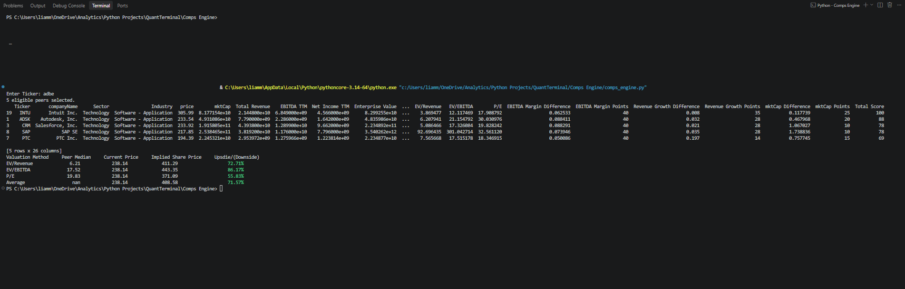
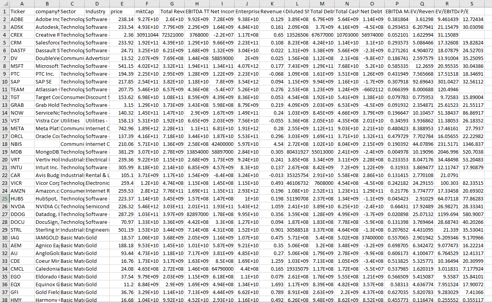

# Python Comparable Company Valuation Engine 
A Python-based relative valuation engine that automates comparable company selection, financial analysis, and valuation using industry peer multiples.

## Overview
This project automates comparable company analysis by identifying industry peers, evaluating financial similarities, and ranking companies through a weighted scoring system.

It integrates a continuously expanding Excel-based stock universe with three valuation methodologies—EV/Revenue, EV/EBITDA, and P/E—to estimate implied share prices using peer median multiples.

## Workflow 

### 1. Data Collection
- Automated peer identification through Financial Modeling Prep (FMP)
- Yahoo Finance company and financial data retrieval
- Custom Excel-based stock universe integration
- New ticker identification and financial database expansion

### 2. Financial Analysis 
- Revenue, EBITDA, and net income analysis
- EBITDA margin and revenue growth calculations
- Enterprise value and net debt calculations
- EV/Revenue, EV/EBITDA, and P/E valuation multiples

### 3. Data Validation 
- Missing and invalid financial data detection
- Nonpositive and infinite valuation multiple filtering
- Minimum valid peer observation requirements
- Insufficient peer-count identification

### 4. Peer Selection 
- Industry-based company filtering
- EBITDA margin similarity scoring (40 points)
- Revenue growth similarity scoring (35 points)
- Market capitalization similarity scoring (25 points)
- Top five comparable company selection

### 5. Relative Valuation 
- Median EV/Revenue valuation
- Median EV/EBITDA valuation
- Median P/E valuation
- Enterprise-to-equity value adjustments
- Implied share price calculations

### 6. Valuation Output 
- Comparable company rankings and financial metrics
- Peer median valuation multiples
- Current market price comparison
- Implied upside/downside by valuation method
- Average implied share price and upside/downside

## Tech Stack 
- Python
- Pandas
- NumPy
- yfinance
- Financial Modeling Prep API
- Microsoft Excel

  

## Example Research Output

 

## Financial Database

